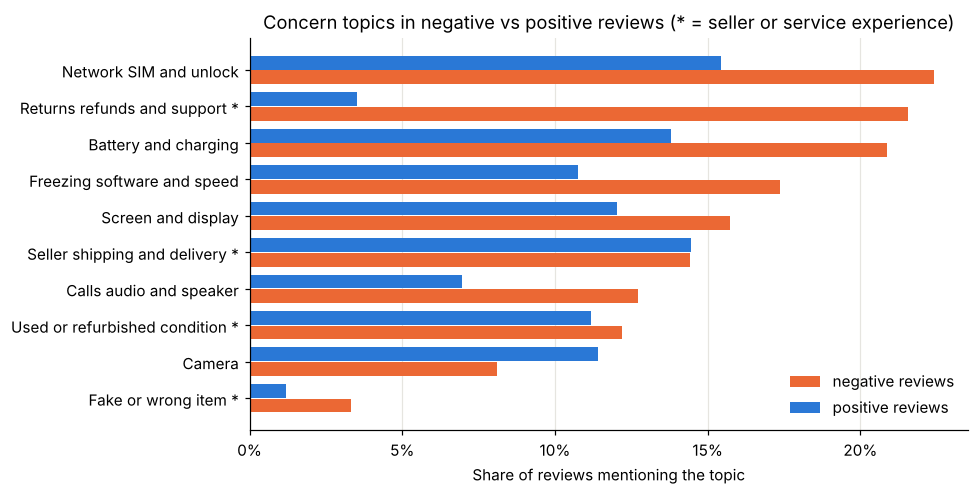

# Amazon Phone Review Sentiment

An end to end NLP project that predicts customer sentiment from review text. It also shows a seller the most common reasons for unhappy customers.

The model is a TF-IDF and logistic regression pipeline with unigrams and bigrams. On reviews of **phones never seen during development** it reaches a macro F1 of **0.918** and catches **92.6%** of negative reviews.

For a detailed analysis, read the blog post at [ridwanalam.site](https://www.ridwanalam.site/blogs/amazon-customer-review-sentiment-analysis).

The full notebook report is in [reports/sentiment_analysis.html](reports/sentiment_analysis.html). Download it and open it in a browser.



**MLOps version:** the same model is also packaged as a production-style system (DVC + MLflow training pipeline, FastAPI service, React frontend, Docker, Prometheus/Grafana, CI). See [docs/MLOPS.md](docs/MLOPS.md).

## Contents

| Path | What it is |
|---|---|
| `sentiment_analysis.ipynb` | The full analysis. Runs from top to bottom with explanations and plots |
| `sentiment_analysis_colab.ipynb` | The same analysis with setup cells for Google Colab |
| `reports/sentiment_analysis.html` | The executed notebook as a web page for quick reading |
| `reports/theme/` and `style_report.py` | Light and dark theme, contents sidebar and page layout added to the HTML report |
| `reports/figures/` | All plots saved as PNG |
| `models/sentiment_pipeline.joblib` | The saved final pipeline (TF-IDF plus logistic regression) |
| `src/predict.py` | Prediction function and a small command line demo |
| `notebook_cells.py` and `markdown_text.py` and `colab_cells.py` and `build_notebook.py` | Source used to generate both notebooks |
| `data/README.md` | How to download the dataset |

## Setup

```bash
git clone <your-repo-url>
cd amazon-review-sentiment
python -m venv .venv
source .venv/bin/activate          # Windows users run .venv\Scripts\activate
pip install -r requirements.txt
```

Python 3.11 or newer works. The saved model was trained with scikit-learn 1.9.1. Use the same version to load it.

## Dataset source

[Amazon Reviews Unlocked Mobile Phones](https://www.kaggle.com/datasets/PromptCloudHQ/amazon-reviews-unlocked-mobile-phones) by PromptCloud on Kaggle. It has 413,840 reviews. The columns used are Product Name and Brand Name and Price and Rating and Reviews and Review Votes.

Download `Amazon_Unlocked_Mobile.csv` and place it in `data/`. The file is not committed because of its size. See `data/README.md`.

## Label rules

| Rating | Label |
|---|---|
| 4 or 5 stars | positive (1) |
| 1 or 2 stars | negative (0) |
| 3 stars | excluded from the classification task |

Star ratings are a proxy for sentiment and not perfect ground truth. The notebook reads more than 20 reviews by hand and discusses cases where text and rating disagree.

## Data preparation

1. A reproducible sample of 50,000 reviews is drawn with `random_state=42`.
2. Empty reviews and reviews with only emoji or punctuation are removed.
3. Duplicate texts are found after lowercasing and removing punctuation. About 40% of rows were copies spread across product variants.
4. Each repeated text is kept **once** with its majority label. Texts whose majority label covers less than 80% of copies are dropped as conflicting.
5. This happens **before** the split so identical text can never appear in both development and test data.

## Split strategy

* The test set holds about 20% of **product names** chosen with `GroupShuffleSplit`. No product name and no review text appears in both sets.
* The test score therefore measures performance on reviews of products absent from development data.
* All preprocessing choices and model comparison and tuning use development data only.
* Inside development data `StratifiedGroupKFold` with 5 folds keeps each product in one fold.
* The final pipeline is frozen and saved before the test set is scored once.

## Results

Development scores are the mean of 5 group aware folds. Test scores come from the held out products.

| Model | Dev macro F1 | Dev accuracy | Dev neg precision | Dev neg recall | Fit time per fold |
|---|---|---|---|---|---|
| Most frequent class | 0.412 | 0.700 | 0.000 | 0.000 | under 0.01 s |
| LogReg unigrams | 0.903 | 0.916 | 0.822 | 0.918 | 0.6 s |
| LogReg unigrams + bigrams | 0.911 | 0.923 | 0.838 | 0.922 | 1.5 s |
| **Final (1,2) min_df=5 C=2** | **0.916** | **0.928** | **0.851** | **0.920** | **1.4 s** |

| Test set (unseen products) | Macro F1 | Accuracy | Neg precision | Neg recall |
|---|---|---|---|---|
| Most frequent class | 0.411 | 0.698 | 0.000 | 0.000 |
| **Final pipeline** | **0.918** | **0.929** | **0.852** | **0.926** |

The final setting was chosen by a rule fixed in advance. Keep settings within one standard deviation of the best macro F1. Then prefer the smallest vocabulary and the stronger regularisation. It is slightly below the top grid score but has higher negative recall and a vocabulary less than half the size.

## Prediction

From the command line

```bash
python src/predict.py "Stopped working after two weeks and the seller never replied"
# {'label': 'negative', 'positive_probability': 0.0156, 'message': 'ok'}
```

Run `python src/predict.py` with no text to start an interactive demo.

From Python

```python
import sys
sys.path.insert(0, "src")
from predict import predict_sentiment

predict_sentiment("Great phone and the battery lasts all day")
# {'label': 'positive', 'positive_probability': 0.98, 'message': 'ok'}

predict_sentiment("   ")
# {'label': None, 'positive_probability': None, 'message': 'Please enter some review text.'}
```

Empty text or whitespace or `None` returns a clear message instead of a prediction.

## Run on Google Colab

1. Open [Google Colab](https://colab.research.google.com) and choose **File** then **Upload notebook**. Select `sentiment_analysis_colab.ipynb`. After you push this repo you can also open it from the **GitHub** tab.
2. Choose **Runtime** then **Run all**.
3. The first setup cell installs the pinned library versions and restarts the session once. Colab may say the session crashed. This is expected. Choose **Run all** again.
4. The data is downloaded from Kaggle by default. If that fails add `KAGGLE_USERNAME` and `KAGGLE_KEY` as Colab secrets or set `DATA_SOURCE = "drive"` and put the CSV in your Google Drive.
5. The last cell downloads `sentiment_results.zip` with the saved model and all figures.

No GPU is needed. A CPU runtime finishes in a few minutes.

## Reproduce the notebook

```bash
python build_notebook.py
jupyter nbconvert --to notebook --execute --inplace sentiment_analysis.ipynb
jupyter nbconvert --to html sentiment_analysis.ipynb --output-dir reports
python style_report.py
```

A full run takes about two minutes on a laptop CPU.

## Main findings for a seller

* **Returns and refunds** appear six times more often in negative reviews than in positive ones.
* **Carrier and SIM compatibility** is the most common complaint topic. Many "unlocked" phones do not work with the buyer's network.
* **Battery and charging** and **freezing or slow software** are the main product complaints.
* **Fake items** are rare but produce the most upvoted negative reviews.

Seller and delivery complaints are kept as negative examples. They are not label noise. The customer really had a negative experience. The notebook explains this distinction and separates product issues from experience issues.
