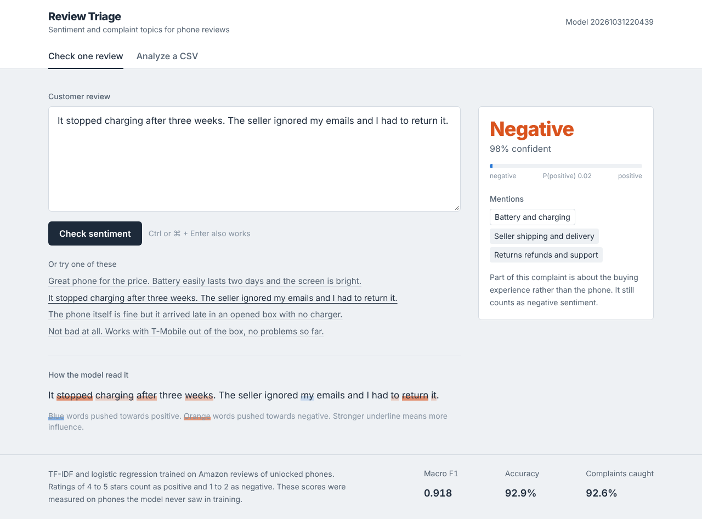
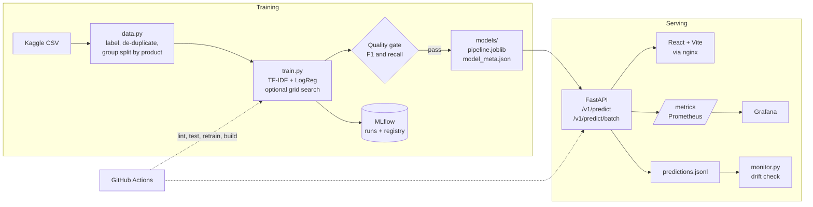
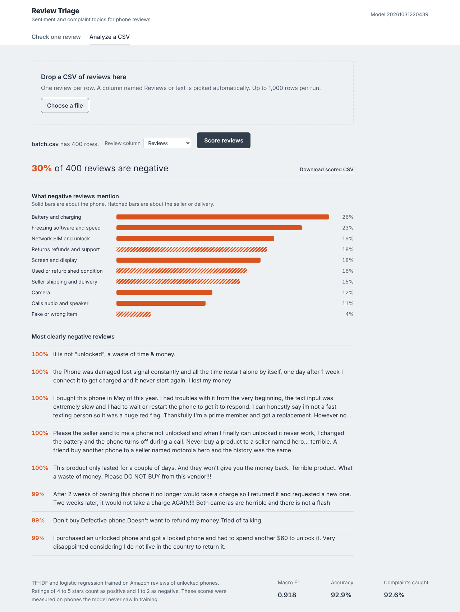

# Review Sentiment MLOps

Production-style ML system that reads Amazon phone reviews, predicts customer sentiment, explains each prediction word by word, and tells a seller what customers complain about. It covers the full lifecycle: reproducible training, experiment tracking, a model registry, a quality gate in CI, a typed REST API, a React frontend, containers, metrics and drift checks.



| | |
|---|---|
| **Test macro F1** | 0.918 on phones never seen in training |
| **Complaints caught** (negative recall) | 92.6% |
| **Model size / latency** | 1.2 MB, under 1 ms per review on CPU |
| **Tests** | 21 tests, 88% coverage |

## Architecture



## Tech stack

Versions were checked against current docs (Context7) and package registries in October 2026.

| Layer | Tools |
|---|---|
| Modelling | scikit-learn 1.9 (TF-IDF, LogisticRegression, StratifiedGroupKFold, GridSearchCV), pandas 3 |
| Pipeline and tracking | DVC 3.67 pipeline (`dvc.yaml` + `params.yaml`), MLflow 3.17 tracking and model registry |
| API | FastAPI 0.162 with lifespan model loading, Pydantic v2 schemas, pydantic-settings config |
| Frontend | React 19, Vite 8, TypeScript 7, Tailwind CSS 4 (`@tailwindcss/vite`), PapaParse |
| Packaging | uv 0.13 with lockfile, multi-stage non-root Docker images, nginx reverse proxy |
| Observability | prometheus-fastapi-instrumentator, custom model metrics, Prometheus, provisioned Grafana dashboard, drift script |
| CI/CD | GitHub Actions (ruff, pytest, retrain on fixture, quality gate, frontend build, container smoke test), GHCR release on tag, Render blueprint |

## Quick start

### Option A. Docker (everything in one command)

```bash
docker compose up --build
```

* App: http://localhost:8080
* API docs (Swagger): http://localhost:8000/docs

Add monitoring with `docker compose --profile monitoring up --build` then open Grafana at http://localhost:3000 (dashboard "Review Sentiment API").

### Option B. Local development

Requires Python 3.12+, [uv](https://docs.astral.sh/uv/) and Node 22.

```bash
make install        # uv sync --all-extras  +  npm install
make api            # FastAPI with reload on :8000
make web            # Vite dev server on :5173 (proxies /api to :8000)
```

A trained model is committed in `models/` so the app works without the dataset.

## Train or retrain the model

1. Download `Amazon_Unlocked_Mobile.csv` from [Kaggle](https://www.kaggle.com/datasets/PromptCloudHQ/amazon-reviews-unlocked-mobile-phones) into `data/`.
2. Run one of these:

```bash
make train          # params.yaml settings, logs to MLflow, fails if the quality gate fails
make tune           # runs the group aware grid search first
uv run dvc repro    # same as make train but only re-runs when data, code or params change
make mlflow-ui      # browse runs and registered model versions on :5000
```

Each run writes `models/sentiment_pipeline.joblib`, `models/model_meta.json` (version, params, metrics, data hash) and `reports/metrics.json`, and registers a new version of `review-sentiment-classifier` in MLflow.

### What the training pipeline does

| Step | Decision |
|---|---|
| Labels | 4 to 5 stars positive, 1 to 2 stars negative, 3 stars excluded |
| Sample | 50,000 reviews, `random_state=42` |
| De-duplication | About 40% of rows are copies of the same text across colour variants. Each text is kept once with its majority label. Texts with less than 80% label agreement are dropped |
| Split | `GroupShuffleSplit` by product name. Test reviews come only from phones absent from training |
| Model selection | 5-fold `StratifiedGroupKFold`. Picks the simplest setting within one SD of the best macro F1 |
| Quality gate | Test macro F1 at least 0.88 and negative recall at least 0.85 |

## API

| Method | Path | Purpose |
|---|---|---|
| GET | `/health` | Liveness and model version |
| POST | `/v1/predict` | One review. Returns label, probability, concern topics and per-word contributions |
| POST | `/v1/predict/batch` | Up to 1,000 reviews. Returns per-item labels and a concern summary for negative reviews |
| GET | `/v1/model` | Model card: params, test metrics, data summary |
| GET | `/v1/concerns` | Concern topic catalogue (product versus customer experience) |
| GET | `/metrics` | Prometheus metrics |

```bash
curl -X POST localhost:8000/v1/predict -H 'content-type: application/json' \
  -d '{"text": "Battery died after two days and the seller ignored my emails"}'
```

```json
{
  "label": "negative",
  "positive_probability": 0.0712,
  "confidence": 0.9288,
  "concerns": ["battery", "shipping"],
  "top_terms": [
    {"term": "died", "weight": -0.7018},
    {"term": "after", "weight": -0.5849},
    {"term": "battery died", "weight": -0.3072}
  ]
}
```

Empty or whitespace-only text returns HTTP 422 with `"Review text is empty. Please enter some text."`. Empty rows in a batch are reported per item and skipped.

**Explanations are exact.** For a linear model the logit equals the intercept plus the sum of tf-idf value times coefficient for each term. `top_terms` returns the largest of those terms, and a unit test checks they add up to the model's decision function.

## Frontend

* **Check one review**: verdict, confidence bar, concern chips, and the review re-rendered with each influential word underlined in the colour of the side it pushed.
* **Analyze a CSV**: drag in a file, pick the review column, see the negative share, a concern breakdown that separates phone problems from seller or delivery problems, the most negative reviews, and download the scored CSV.



## Monitoring

* Request rate and latency per route from `prometheus-fastapi-instrumentator`.
* Model metrics: `sentiment_predictions_total{label}`, `sentiment_positive_probability` and `sentiment_text_words` histograms.
* Every prediction is appended to `logs/predictions.jsonl`. `make monitor` compares recent traffic with the training baseline (negative share, review length, mean confidence) and exits with code 2 on drift, so it can run on a schedule.

## Deploy

* **Render**: push the repo and create a Blueprint from `render.yaml` (API as a Docker web service, frontend as a static site).
* **Any container host** (Fly.io, Railway, Cloud Run, ECS): push a tag like `v1.0.0` and the release workflow publishes `ghcr.io/<you>/<repo>-api` and `-web`.

## Project layout

```
├── src/sentiment_mlops/
│   ├── data.py          labelling, de-duplication, group split
│   ├── model.py         pipeline factory, explanations, concern topics
│   ├── train.py         training, evaluation, MLflow, quality gate
│   ├── monitor.py       drift check on the prediction log
│   ├── config.py        params.yaml loader and env settings
│   └── api/             FastAPI app and Pydantic schemas
├── frontend/            React + Vite + Tailwind app
├── models/              committed production model and its metadata
├── tests/               pytest suite and a 3,000-row fixture
├── docker/              Dockerfiles and nginx config
├── monitoring/          Prometheus and Grafana provisioning
├── .github/workflows/   CI and release pipelines
├── params.yaml  dvc.yaml  docker-compose.yml  render.yaml  Makefile
```

## Limitations

* Star ratings are a noisy proxy for sentiment and 3-star reviews are excluded.
* Concern topics come from a transparent keyword dictionary, not a trained aspect model.
* A bag-of-words model struggles with "great but..." reviews. A fine-tuned transformer is the natural next step, and the API contract would stay the same.

## Resume bullets

* Built an end-to-end sentiment platform on Amazon phone reviews (50K-review sample of a 414K dataset) with group-aware evaluation on unseen products (macro F1 0.92, 93% complaint recall), MLflow tracking and registry, DVC pipeline, CI quality gate.
* Shipped a FastAPI service with Pydantic v2 schemas, exact per-word explanations, batch scoring and Prometheus metrics, containerised with uv multi-stage non-root images.
* Developed a React 19 + TypeScript + Tailwind 4 frontend that highlights the words behind each prediction and turns a CSV of reviews into a seller-facing complaint breakdown.
* Automated lint, tests (88% coverage), retraining smoke tests, container smoke tests and GHCR releases with GitHub Actions, and added drift monitoring on live traffic.

## Data source and license

Dataset: [PromptCloud, Amazon Reviews: Unlocked Mobile Phones](https://www.kaggle.com/datasets/PromptCloudHQ/amazon-reviews-unlocked-mobile-phones) on Kaggle. The raw file is not committed. `tests/fixtures/sample_reviews.csv` is a 3,000-row random sample used only for tests.
